<picture><source media="(prefers-color-scheme: dark)" srcset="assets/banner-dark.svg">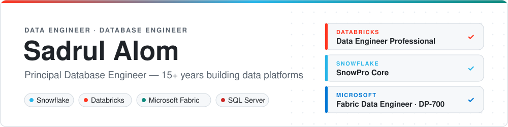</picture>

  
  
  

## About

I design and run data platforms end to end: ingestion, medallion lakehouses, dimensional warehouses, data quality,
and the databases underneath them. Most of my work lands on **Snowflake**, **Databricks** and **Microsoft Fabric**,
backed by 15+ years of **SQL Server, PostgreSQL and MySQL** administration.

- **Now:** Principal Database Engineer at RELISOURCE US INC. I lead a DBA team and deliver data platform work for US clients.
- **Recently:** Facility Master and Commercial Master on Snowflake: healthcare facility and commercial master data with entity matching, data-steward apps in Streamlit in Snowflake and gated Azure DevOps releases.
- **Exploring:** blockchain for data and finance, including tokenisation, verifiable lineage and payment rails.
- **Open to:** data engineering, database administration and cloud data platform roles (remote, hybrid or on-site).

## Certifications

<picture><source media="(prefers-color-scheme: dark)" srcset="assets/certifications-dark.svg">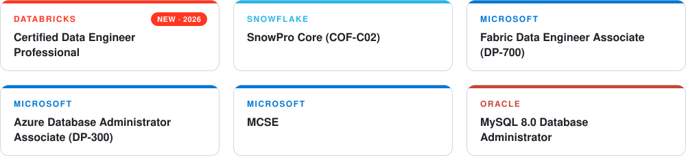</picture>

## Featured work

<picture><source media="(prefers-color-scheme: dark)" srcset="assets/card-facility-master-dark.svg">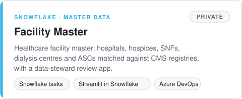</picture>
<picture><source media="(prefers-color-scheme: dark)" srcset="assets/card-commercial-master-dark.svg">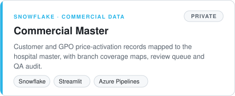</picture>

<a href="https://github.com/sadrulemail/CareFlow-Lakehouse"><picture><source media="(prefers-color-scheme: dark)" srcset="assets/card-careflow-dark.svg">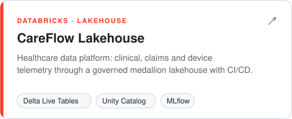</picture></a>
<a href="https://github.com/sadrulemail/d365fo-fabric-lakehouse-migration"><picture><source media="(prefers-color-scheme: dark)" srcset="assets/card-d365-fabric-dark.svg">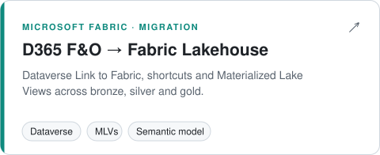</picture></a>

<a href="https://github.com/sadrulemail/bangladesh-payments-infrastructure"><picture><source media="(prefers-color-scheme: dark)" srcset="assets/card-takarail-dark.svg">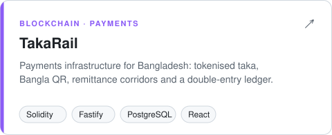</picture></a>
<a href="https://github.com/sadrulemail/rwa-tokenization-platform"><picture><source media="(prefers-color-scheme: dark)" srcset="assets/card-rwa-dark.svg">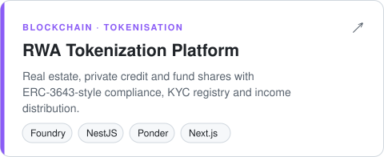</picture></a>

<a href="https://github.com/sadrulemail/blockchain-data-management"><picture><source media="(prefers-color-scheme: dark)" srcset="assets/card-dataledger-dark.svg">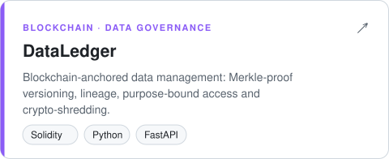</picture></a>
<a href="https://github.com/sadrulemail/SQLServer_HealthCheck"><picture><source media="(prefers-color-scheme: dark)" srcset="assets/card-sql-healthcheck-dark.svg">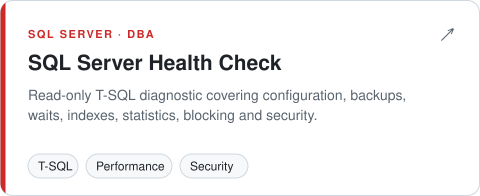</picture></a>

<b>More repositories</b>

 

**Lakehouse and pipelines:**
[FinFlow Fabric Edition](https://github.com/sadrulemail/FinFlow-Fabric) ·
[RetailFlow Lakehouse](https://github.com/sadrulemail/Databricks-Lakehouse) ·
[Retail OLTP to Databricks (DLT)](https://github.com/sadrulemail/retail-databricks-medallion-dlt) ·
[Declarative Pipelines study](https://github.com/sadrulemail/Databricks-Declarative-Pipelines-) ·
[Fabric monitoring and notification](https://github.com/sadrulemail/fabric-monitoring-notification) ·
[Fabric SQL endpoint refresh](https://github.com/sadrulemail/fabric-medallion-pipeline-sql-end-point-refresh)

**Snowflake and dbt:**
[Snowflake Multi-Stage Browser](https://github.com/sadrulemail/Snowflake-Multi-Stage-Browser) ·
[Snowflake pipeline automation (S3 + Iceberg)](https://github.com/sadrulemail/snowflake-data-pipeline-automation) ·
[E-commerce and ads warehouse (dbt)](https://github.com/sadrulemail/FB-ADs-Shopify-sales-data-dbt-snowflake-etl) ·
[Streamlit sales dashboard](https://github.com/sadrulemail/Streamlit-Sales-Dashboard-App) ·
[Snowflake notebooks data cleansing](https://github.com/sadrulemail/snowflake-notebooks-data-cleansing) ·
[Snowflake VPC endpoint](https://github.com/sadrulemail/snowflake-vpc-endpoint)

**DBA script libraries:**
[Snowflake](https://github.com/sadrulemail/SnowflakeScripts) ·
[PostgreSQL](https://github.com/sadrulemail/PostgresqlScripts) ·
[MongoDB](https://github.com/sadrulemail/MongoDB_Scripts) ·
[Oracle](https://github.com/sadrulemail/oracle_scripts) ·
[PowerShell](https://github.com/sadrulemail/Powershell)

## Toolbox

<picture><source media="(prefers-color-scheme: dark)" srcset="assets/stack-dark.svg">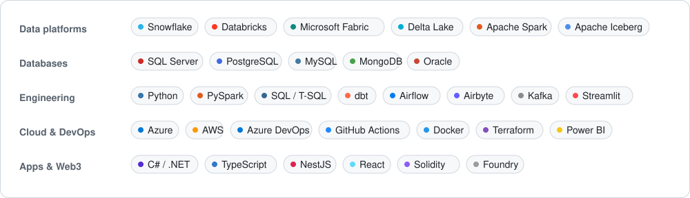</picture>

## Experience

<b>Principal Database Engineer at RELISOURCE US INC since 2020. Full history and highlights.</b>

 

| Role | Company | Period |
|---|---|---|
| **Principal Database Engineer** | RELISOURCE US INC (remote) | Mar 2020 – Present |
| Associate Manager, Application Development | BRAC Bank Limited | Dec 2019 – Mar 2020 |
| Database Administrator & Developer / Software Engineer | Trust Bank Limited | Mar 2014 – Dec 2019 |
| Associate Software Engineer | BRAC-Aarong | May 2013 – Mar 2014 |
| Software Programmer | Asiatic Laboratories Ltd. | Jan 2011 – Apr 2013 |

**Highlights at RELISOURCE**

- Architected a healthcare **Enterprise Data Warehouse on Snowflake**: multi-source star schema, ADLS to Snowflake ELT, incremental and full-refresh orchestration with audit logging.
- Built **Facility Master** on Snowflake: public-registry ingestion, entity matching, a steward review app and gated Azure DevOps releases to sandbox and production.
- Built **Commercial Master** on top of it: customer and GPO price-activation mapping to the hospital master, branch coverage maps, review queue and QA audit.
- Engineered **Microsoft Fabric medallion pipelines** (D365 F&O to bronze, silver and gold Materialized Lake Views), an automated data-validation tool and a pipeline monitoring store.
- Led a **Snowflake to NetSuite** ERP data migration with cleansing, accuracy and completeness checks.
- Administer SQL Server, MySQL and PostgreSQL estates and lead the DBA team.

**Education:** Master of Engineering (MEng), Information Systems Security, Bangladesh University of Professionals, 2022

